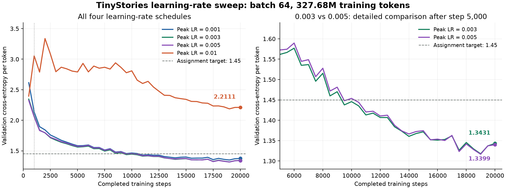
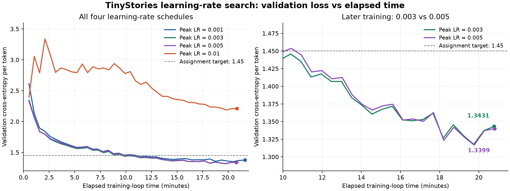
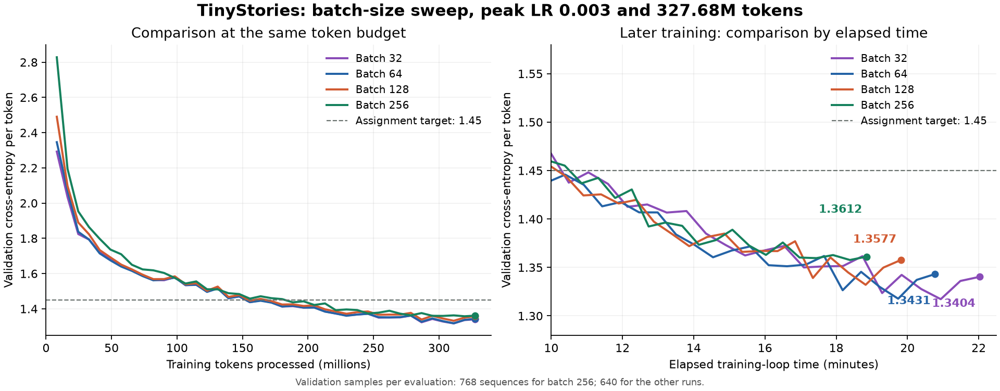

# TinyStories 超参数搜索记录

本报告汇总已完成的学习率搜索和 batch size 对比，数据来自各次训练保存的 `config.json` 与 `metrics.jsonl`。共完成 **7 次独立训练**；batch 64、学习率 0.003 的同一次实验同时作为两组对比的基线，没有重复计算为两次训练。

主要结果：在已测试配置中，**batch 64、峰值学习率 0.005 的最终验证 loss 数值最低，为 1.3399**，但它与学习率 0.003 的差距很小。固定学习率 0.003 后，batch 32 与 64 的效果接近；增大到 128、256 可以小幅提速，但最终验证效果略差。以下结论均限定于当前模型、数据、训练预算及单个随机种子。

## 实验设置与评价口径

### 数据、模型和优化器

使用 TinyStories 训练集与验证集，配合自行训练的 10,000 词表 BPE 分词器。原始文本已经编码成 `uint16` token 文件，训练时通过 `np.memmap` 读取并随机采样连续片段。

| 项目 | 设置 |
|---|---|
| 训练 / 验证数据 | `tinystories_train.bin` / `tinystories_valid.bin` |
| 词表大小 | 10,000，包含 `<\|endoftext\|>` |
| 上下文长度 | 256 |
| 模型宽度 `d_model` | 512 |
| Transformer 层数 / 注意力头数 | 4 / 16 |
| 前馈层宽度 `d_ff` | 1344 |
| RoPE theta | 10,000 |
| RMSNorm epsilon | 1e-5 |
| 优化器 | 自行实现的 AdamW |
| AdamW betas / epsilon | (0.9, 0.999) / 1e-8 |
| 权重衰减 / 梯度裁剪阈值 | 0.01 / 1.0 |
| 云端启动配置 / 参数精度 | 单张 B200，CUDA / float32 |
| 随机种子 | 42 |
| 初始化方式 | 每次从头训练，不加载前一次模型 |

每次训练的累计 token 预算固定为：

```text
batch_size × max_iters × context_length = 327,680,000 tokens
```

这是训练过程中累计处理的 token 数，不代表不重复地遍历了相同数量的独立文本。

### 学习率调度

所有实验均采用 **线性预热 + 余弦退火**：前 5% 的更新步数用于预热，此后在剩余步数内逐渐下降。最低学习率固定为峰值的 10%。因此，学习率实验比较的是整条学习率曲线的缩放，而不只是峰值处的单次变化。

`cosine_cycle_iters` 是从训练开始计数的退火结束位置，不是余弦阶段的开始位置。它设为总步数时，训练会正常进入余弦阶段，只是不会继续进入退火结束后的恒定最低学习率阶段。训练索引从 0 开始，最后一次更新使用的学习率非常接近最低值。

日志中的 `lr` 是调度器输出、传入 AdamW 的基础学习率，不是 AdamW 内部经过偏差修正的 `lr_t`，也不是每个参数的实际更新量。

### 指标定义

- **最终验证 loss**：完成全部更新后，最后一次验证得到的平均每 token 交叉熵，是本报告比较最终模型的主要指标。
- **最低验证 loss**：所有已记录验证点中的最小值，不等于已保留模型的评估结果。
- **首次达标**：日志中第一次出现验证 loss ≤ 1.45；这是离散验证记录中的首次观测，不是精确的跨越时刻。
- **困惑度**：`exp(验证 loss)`。
- **日志计时**：从训练循环开始，到最后一次验证记录为止，包含中途验证及此前的检查点保存；不包含排队、镜像准备、模型初始化、最后一次保存和云端收尾检查，不等同于完整运行时间或计费时长。

TinyStories 正常 GPU 配置的验证 loss 目标为 **≤ 1.45**，见[作业讲义第 7.2 节](../cs336_assignment1_basics.pdf)。

## 第一次

本阶段固定 batch size 64，搜索学习率。

### 搜索策略

采用手动的粗搜与区间细搜，没有使用 TPE 或贝叶斯优化：

1. 先以 0.001 建立基线，确认模型能够达到作业损失目标。
2. 将峰值提高到 0.01，观察更大更新幅度是否加快收敛，以及是否出现失稳。
3. 发现 0.01 效果较差后，测试两者之间的 0.003。
4. 再测试 0.005，判断继续增大学习率是否还有收益。

四次实验均为 20,000 步，预热 1,000 步，余弦退火结束位置为 20,000；每 500 步验证 10 个 batch，每 1,000 步保存检查点，每 50 步记录训练 loss。

### 结果汇总

| 实验 | 峰值 / 最低学习率 | 最终验证 loss | 最低验证 loss | 最低值所在步数 | 首次达标步数 | 日志计时 |
|---|---|---:|---:|---:|---:|---|
| L1：基线 | 0.001 / 0.0001 | 1.3756 | 1.3498 | 19,000 | 11,000 | 21 分 38 秒 |
| L2：大步长 | 0.01 / 0.001 | 2.2111 | 2.1868 | 19,000 | 未达到 | 20 分 50 秒 |
| L3：区间细搜 | 0.003 / 0.0003 | 1.3431 | 1.3177 | 19,000 | 9,500 | 20 分 46 秒 |
| L4：区间细搜 | 0.005 / 0.0005 | **1.3399** | **1.3167** | 19,000 | 9,500 | 20 分 48 秒 |

表格按实际搜索顺序排列；损失值保留四位小数。



图 1：各学习率下的验证学习曲线。左图包含所有候选，右图放大显示 0.003 和 0.005 的后期差异。



图 2：同组实验按日志计时对齐。不同实验的硬件运行波动也会影响耗时，不把数秒级差异作为学习率优劣的依据。

### 结果分析

**0.001 是有效的基线，0.003 在本次运行中带来了较一致的改善。** 0.003 的 40 个验证记录都低于基线的对应记录，最终 loss 降低约 0.0324，困惑度从约 3.96 降至 3.83。首次达到 1.45 的位置从 11,000 步提前到 9,500 步，相当于从约 1.80 亿训练 token 减少到约 1.56 亿。

**0.01 前期下降较快，但预热后失稳，长时间收敛受阻。** 第 500 步验证 loss 为 2.3952，优于基线的 2.6157；但第 1,000 步上升到 3.0546，第 2,000 步达到 3.3378。训练与验证 loss 同时变差，因此不是典型的“训练 loss 下降、验证 loss 上升”的过拟合表现。此后验证 loss 长期在较高位置波动，后期随着学习率下降才逐渐恢复，最终仍为 2.2111。

0.01 的记录中没有 NaN 或无穷大，后期还能恢复下降，因此应描述为“失稳、收敛受阻、最终效果差”，不直接等同于持续数值发散。日志没有梯度范数、更新范数等信息，不能据此断言发生了梯度爆炸，也不能精确定位稳定性边界。

**0.005 的最终记录略优于 0.003，但没有形成明显的全程优势。** 两者最终 loss 只差约 0.00325，困惑度差异约 0.32%；0.005 在 40 个验证点中只有 10 个更低，第 2,000～15,000 步大多是 0.003 表现更好。最后 5 次验证的平均 loss 分别为 1.3328（0.005）与 1.3347（0.003），同样非常接近。

因此，按最终验证记录排序，0.005 是本组数值上的第一名；但不能说它显著优于 0.003，也没有证据声称 0.003 明显比 0.005 更稳定。两者都没有出现 0.01 那样的明显失稳。

还需注意，AdamW 的权重衰减项包含基础学习率。虽然各实验的 `weight_decay` 都是 0.01，放大学习率曲线也会增强累计权重衰减，结果不能全部归因于更新震荡。

### 本阶段结论

在当前训练配置下，已测试的 0.003、0.005 都能获得较好的验证效果，0.01 则明显过大。后续 batch size 实验选择 **0.003 / 0.0003** 作为固定学习率曲线，以延续同一基线；这是实验设计的选择，不表示否认 0.005 的最终 loss 略低，也不表示已经找到全局最优学习率。

## 第二次：batch size 对比

### 控制变量与对齐方式

固定峰值学习率 0.003、最低学习率 0.0003，以及模型、优化器参数和随机种子，比较 batch size 32、64、128、256。其中 batch 64 直接复用 L3。

为了公平比较数据效率，改变 batch 时按比例调整总步数、预热步数、余弦结束位置和验证间隔，使训练 token 预算、预热 token 预算和验证发生的位置保持一致。每个实验均记录 40 次验证。

| Batch size | 总更新步数 / 余弦结束位置 | 预热步数 | 验证间隔（步） | 每次验证 batch 数 | 每次验证序列数 |
|---:|---:|---:|---:|---:|---:|
| 32 | 40,000 | 2,000 | 1,000 | 20 | 640 |
| 64 | 20,000 | 1,000 | 500 | 10 | 640 |
| 128 | 10,000 | 500 | 250 | 5 | 640 |
| 256 | 5,000 | 250 | 125 | 3 | 768 |

所有配置均在训练约 1,638 万 token 后结束预热，每增加 819.2 万训练 token 进行一次验证，每增加 1,638.4 万训练 token 保存一次检查点。batch 256 的训练日志为每 25 步一次，记录密度比其他组低，但验证点仍按相同 token 位置对齐。

由于 640 不能被 256 整除，batch 256 每次验证取 768 条序列，比其他组多 20%。这不影响验证 loss 仍然是平均值，但会改变估计的波动和实际抽到的文本，不能视为严格相同验证样本的配对比较。

### 结果汇总

| Batch size | 最终验证 loss | 最低验证 loss | 最低值所在步数 | 日志计时 | 平均吞吐量（训练 token/s） |
|---:|---:|---:|---:|---|---:|
| 32 | **1.3404** | **1.3172** | 38,000 | 22 分 02 秒 | 约 247,870 |
| 64 | 1.3431 | 1.3177 | 19,000 | 20 分 46 秒 | 约 262,900 |
| 128 | 1.3577 | 1.3320 | 9,500 | 19 分 49 秒 | 约 275,607 |
| 256 | 1.3612 | 1.3577 | 4,875 | **18 分 51 秒** | **约 289,681** |

平均吞吐量用 327,680,000 除以日志计时计算，包含过程中验证与此前保存的开销，不是纯 GPU 前向、反向计算吞吐量。

| Batch size | 首次达标步数 | 首次达标时训练 token 数 | 首次达标日志计时 |
|---:|---:|---:|---|
| 32 | 19,000 | 155,648,000 | 10 分 30 秒 |
| 64 | 9,500 | 155,648,000 | 9 分 53 秒 |
| 128 | 4,750 | 155,648,000 | **9 分 25 秒** |
| 256 | 2,875 | 188,416,000 | 10 分 51 秒 |



图 3：左图比较相同训练 token 预算下的效果，右图比较训练后期相近耗时下的效果。不同 batch 的步数含义不同，不能直接根据“更少步数达标”判断其收敛快了多少倍。

### 结果分析

**Batch 32 与 64 的效果基本接近。** Batch 32 的最终 loss 只低约 0.00277，困惑度约低 0.28%；40 个按 token 对齐的验证点中，它有 21 个更好。更新次数虽然翻倍，但首次达标所需的训练 token 数没有减少，最终效果也没有大幅改善。同时，完整预算的日志计时比 batch 64 增加约 6.1%。

**Batch 128 小幅提速，效果略差。** 相比 batch 64，计时缩短约 4.6%，但最终 loss 高约 0.0146。在相同 token 位置的 40 次验证记录中，batch 128 都略差。两者首次达标所需 token 数相同，batch 128 因吞吐量较高而更早在日志时间上达标。

**Batch 256 跑完整个预算最快，但达到目标需要更多数据。** 相比 batch 64，它节省约 9.2% 的日志时间，但最终 loss 高约 0.0180；相比 batch 128，仅再节省约 4.9%，最终 loss 则高约 0.0035。后一个差距很小，且验证样本数量不同，不能认定两者存在稳健的最终质量差距。

按本次离散验证记录，batch 256 首次达标时消耗约 1.88 亿训练 token，比其他三组的约 1.56 亿多约 21.1%，首次达标的日志计时也更晚。因此，“跑完相同 token 预算最快”与“最快达到目标质量”是不同指标。

增大 batch 后，更新次数减少，但每步耗时增加。日志中典型每步耗时约为 33、61、117、223 毫秒，对应 batch 32、64、128、256。因此，batch 翻倍并没有使总耗时减半。日志没有显存占用、GPU 利用率等数据，不能据此确定具体瓶颈或 GPU 支持的最大 batch。

### 为什么改变 batch 会影响效果

改变 batch 会同时影响梯度估计的波动、每个 token 预算内的参数更新次数，以及 AdamW 一阶、二阶矩的演化。相同数据分两次更新，与合并后只更新一次不等价；固定学习率也不保证对不同 batch 都合适。

虽然各组的 betas 和权重衰减系数没有改变，但它们按更新次数发挥作用，累计效果仍然不同。因此，这里是在固定一套优化器设置下研究 batch 改变后的实际训练行为，不是单独隔离“梯度噪声”一个因素。不能用这些结果证明“噪声越大，泛化一定越好”或“batch 越小越好”。

### 本阶段结论

在学习率 0.003 和相同 token 预算下，batch 32、64 的效果接近，batch 128、256 略差；batch 增大带来的吞吐量提升有限。**Batch 64 是当前已测试配置中效果与训练时间较均衡的基线。** 这不代表各 batch 分别调好学习率后仍会保持相同排序。

## 综合结论与适用范围

1. **按已记录的最终验证 loss 排名**：batch 64、峰值学习率 0.005 最低，为 1.3399。Batch 32、学习率 0.003 的结果为 1.3404，数值也非常接近；只有单次运行，不能据此宣称稳定优胜。
2. **作为后续控制变量实验的基线**：使用 batch 64、峰值学习率 0.003、最低学习率 0.0003 是合理选择，因为已完成整组围绕该配置的 batch 对比，且效果与速度较均衡。这里的选择与“最终记录数值最低”是两个评价口径。
3. **作业损失目标**：7 次实验中有 6 次最终验证 loss ≤ 1.45；只有学习率 0.01、batch 64 未达标。
4. **搜索策略的收获**：较大步长可能在短训练中显得更快，但不能仅凭预热期间或前几百步的 loss 选择完整训练的学习率；batch 变化则需要同时比较 token 效率和时间效率。

7 次完整训练累计处理 **2,293,760,000 个训练 token**，日志计时之和约 **2 小时 24 分 44 秒**。这是训练预算和日志时间的汇总，不是云端账单时长。

## 实验局限与尚未完成的部分

- **仅有一个随机种子**：所有实验使用 seed 42，无法量化不同初始化与训练采样带来的运行间差异；小于数个千分点的 loss 差异不能直接解释为确定优势。
- **验证集没有固定为同一批样本**：每次验证都会重新随机抽样，最终值和最低值都受文本难度影响。若要严格区分相近模型，应对保留的检查点使用同一组更充分的验证数据。
- **Batch 256 的采样额外差异**：训练与验证都通过 NumPy 的全局随机数生成器采样。该组每次多抽取验证序列，可能改变后续训练的随机采样序列；相同 seed 不保证跨实验逐样本一致。这些实验控制的是采样分布和累计训练量。
- **没有为各 batch 重新调学习率**：目前只完成固定学习率 0.003 的对比，尚不能判断不同 batch 各自调优后的最好效果。
- **最低验证记录不等于保留的模型**：当前只使用 `latest.pt`，定期保存会覆盖旧文件，最后留下的是最终步。部分最低点的权重已被覆盖；batch 256 的最低点在第 4,875 步，也不是定期保存位置。不能把表中的最低 loss 当成当前 `latest.pt` 的指标。
- **失稳不等于持续发散**：0.01 出现明显回升与收敛受阻，但没有记录到非有限损失，后期仍恢复下降。作业要求包含发散运行时，不能仅用这次较差的最终结果声称已严格满足。
- **Batch 覆盖范围尚不完整**：已测试 32、64、128、256，尚未测试作业提到的 batch 1，也没有探索实际 GPU 显存上限；256 不能被当成硬件上限。

## 原始记录与模型索引

下表链接指向本地下载的实际产物。对应的云端路径为 `cs336-data/runs/<实验目录名>/`，目录名可从链接路径查看。图件单独存放在本报告旁的 `assets/hyperparameter-search/`，便于随报告一起保留。

| 实验 | 配置 | 指标日志 | 最终模型 |
|---|---|---|---|
| L1：lr 0.001，batch 64 | [config.json](../data/runs/tinystories-baseline-lr1e-3-20261110/config.json) | [metrics.jsonl](../data/runs/tinystories-baseline-lr1e-3-20261110/metrics.jsonl) | [latest.pt](../data/runs/tinystories-baseline-lr1e-3-20261110/latest.pt) |
| L2：lr 0.01，batch 64 | [config.json](../data/runs/tinystories-lr1e-2/config.json) | [metrics.jsonl](../data/runs/tinystories-lr1e-2/metrics.jsonl) | [latest.pt](../data/runs/tinystories-lr1e-2/latest.pt) |
| L3：lr 0.003，batch 64 | [config.json](../data/runs/tinystories-lr3e-3/config.json) | [metrics.jsonl](../data/runs/tinystories-lr3e-3/metrics.jsonl) | [latest.pt](../data/runs/tinystories-lr3e-3/latest.pt) |
| L4：lr 0.005，batch 64 | [config.json](../data/runs/tinystories-lr5e-3/config.json) | [metrics.jsonl](../data/runs/tinystories-lr5e-3/metrics.jsonl) | [latest.pt](../data/runs/tinystories-lr5e-3/latest.pt) |
| B32：lr 0.003，batch 32 | [config.json](../data/runs/tinystories-lr3e-3-bs32/config.json) | [metrics.jsonl](../data/runs/tinystories-lr3e-3-bs32/metrics.jsonl) | [latest.pt](../data/runs/tinystories-lr3e-3-bs32/latest.pt) |
| B128：lr 0.003，batch 128 | [config.json](../data/runs/tinystories-lr3e-3-bs128/config.json) | [metrics.jsonl](../data/runs/tinystories-lr3e-3-bs128/metrics.jsonl) | [latest.pt](../data/runs/tinystories-lr3e-3-bs128/latest.pt) |
| B256：lr 0.003，batch 256 | [config.json](../data/runs/tinystories-lr3e-3-bs256/config.json) | [metrics.jsonl](../data/runs/tinystories-lr3e-3-bs256/metrics.jsonl) | [latest.pt](../data/runs/tinystories-lr3e-3-bs256/latest.pt) |
