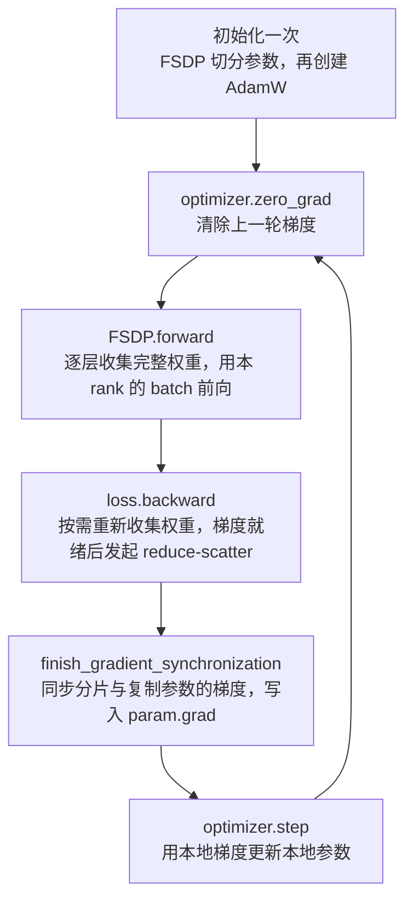
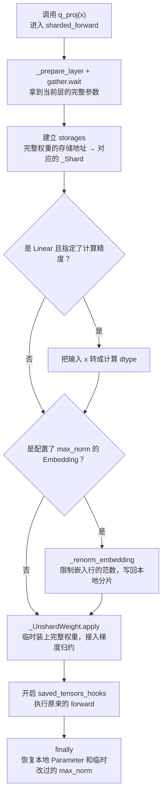
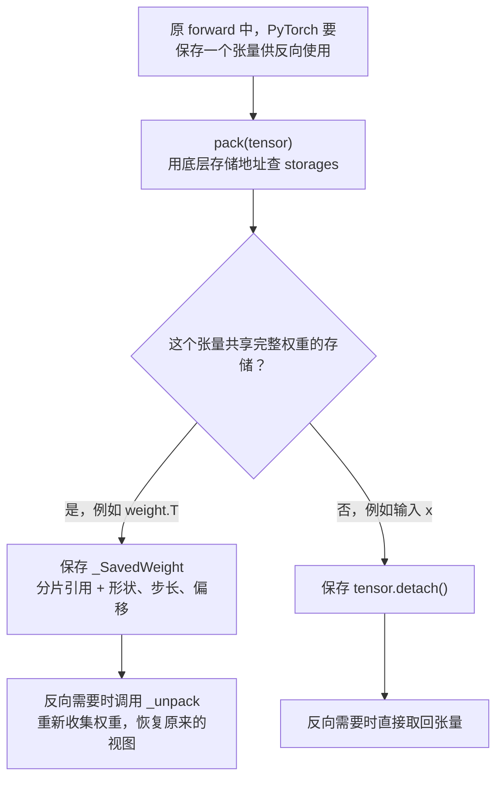

# FSDP 代码详解

这份笔记跟踪两张 GPU 中的 **rank 0**。两张卡处理各自的 batch。分片参数平时只在每张卡上保存一段，前向临时拼出完整权重，反向按需重新拼出权重。梯度最后分回对应的 rank，由普通 AdamW 更新。这里的「一层」指一个被包装的 `Linear` 或 `Embedding`，例如 `q_proj`、`k_proj`、`v_proj`，每个模块各自收集权重。 [FSDP 实现](../cs336_systems/fsdp.py)

## 1. 一轮训练怎么走



| 比较项目 | 之前的 `ShardedOptimizer` | 现在的 FSDP |
|---|---|---|
| 训练时的模型权重 | 每个 rank 保存一份完整模型权重 | `Linear` 和 `Embedding` 的权重按元素分片，归一化层等参数保持复制 |
| 更新的粒度 | 一个完整参数由一个 rank 更新 | 同一个参数的不同分片由不同 rank 更新 |
| AdamW 状态 | 每个 rank 为自己负责的整块参数保存一阶矩和二阶矩 | 每个 rank 为本地分片保存一阶矩和二阶矩 |
| 权重何时通信 | 更新后由负责的 rank 广播完整参数 | 前向和反向用到权重时，临时 `all-gather` |

例如 `q_proj.weight` 在 `ShardedOptimizer` 里可以由 rank 0 更新整块矩阵，再广播到 rank 1。在 FSDP 里，rank 0 更新前半段，rank 1 更新后半段。 [ShardedOptimizer 实现](../cs336_systems/sharded_optimizer.py)

## 2. 初始化 · `FSDP.__init__()`

`self.module = module` 把原模型注册为子模块，之后 `fsdp_model.parameters()` 就能遍历它的参数。`world_size` 是进程数，`_rank` 是当前进程编号。单进程时 `world_size=1`，本地分片覆盖整个参数。`_uses_nccl` 决定反向梯度是否走专门的 CUDA 归约流。

1. **挑出要分片的层。** `isinstance(layer, (nn.Linear, nn.Embedding, Linear, Embedding))` 同时匹配 PyTorch 原生层和作业中自定义的层。`_layers` 的结构是 `{层对象: {"weight": 参数对象, "bias": 参数对象}}`。`named_parameters(recurse=False)` 只拿当前层直接注册的参数。`sharded` 把各层参数字典里的值汇总成集合，方便判断某个 `Parameter` 是否需要分片。自定义线性层只有 `weight`，因此只发起一次参数收集。
2. **统一初始值。** 多 rank 时，遍历全模型参数并从 rank 0 广播初始值。这样每个 rank 都从同一份完整权重切出自己的那段。归一化层等复制参数加入 `_replicated` 并保留完整数据。
3. **记录完整形状，再切分。** `_Shard(param, param.shape, param.numel())` 引用本地 `Parameter`，并记住切分前的形状和真实元素数。`shard_size` 是完整参数的元素数除以 rank 数后向上取整，`start = rank * shard_size`，`length` 是从这里开始能复制的真实元素数。
4. **替换参数的数据。** `new_zeros()` 在原设备上分配分片，`copy_()` 把展平后的有效值复制进去，`param.data = shard` 让原来的 `Parameter` 持有这块较小的存储。`layer.weight` 仍指向同一个已注册的对象。
5. **安装前向包装。** `_wrap_layer(layer, params)` 给每个目标层替换前向入口。`self._layers.items()` 在循环中同时给出层对象和它的参数字典。

例如权重展平后有 5 个元素 `[a, b, c, d, e]`，两个 rank 的 `shard_size` 都是 3。

| | `start` | `length` | 本地权重 |
|---|---:|---:|---|
| rank 0 | 0 | 3 | `[a, b, c]` |
| rank 1 | 3 | 2 | `[d, e, 0]` |

`Linear` 和 `Embedding` 都按展平后的元素切分，所以 Embedding 的同一行可能跨两个 rank。收集时拼出 `[a, b, c, d, e, 0]`，先按 `_Shard.numel` 去掉补零，再按 `_Shard.shape` 恢复原形状。

### 主权重与计算精度

| 设置 | 本地分片的 dtype | 收集与计算时的权重 dtype |
|---|---|---|
| `compute_dtype=None` | 沿用原参数 dtype | 沿用参数 dtype |
| 例如 `compute_dtype=torch.float16` | FP32 主权重 | FP16 |

转换发生在 `_gather()` 的 `shard.parameter.detach().to(dtype=dtype)`，然后 `all-gather` 拼接转换好的分片。例如 FP32 的 `1.0001` 转成 FP16 会舍入成 `1.0`。该值在所属 rank 上以 FP32 保留给 AdamW，而所有 rank 的前向都用拼出来的同一个 FP16 值。AdamW 反复更新主权重时，小更新更容易保留下来。

## 3. 前向 · 收集、预取、临时换上权重

### `forward()` 和 `_prepare_layer()` 如何配合

`FSDP.forward()` 管整个模型的一次前向。它清空 `_current_order`，如果有上一次的 `_forward_order`，就发起第一层的收集，再把位置参数和关键字参数都交给原模型。每进入一个分片层，`_prepare_layer()` 就把它加入 `_current_order`，取走匹配的预取任务，或者现场发起收集。当前层和上次同位置的层匹配时，可以预取下一层。前向正常结束后，用本轮实际顺序更新 `_forward_order`。

| 函数或状态 | 作用 |
|---|---|
| `_gather(shard, dtype)` | 发起**一个参数**的异步 `all-gather`。为输出创建缓冲区，去掉尾部填充并恢复形状，把张量和通信句柄封装成 `_Gather`。 |
| `_gather_layer(layer)` | 对**一层实际存在的每个参数**调用 `_gather()`，返回参数名到 `_Gather` 的映射。 |
| `_Gather.wait()` | 等通信结果可用，返回完整张量。 |
| `_prefetched` | 保存一个预取位置，内容是目标层和该层各参数的收集任务。 |
| `_discard_prefetch()` | 等待已发起但未用到的任务，再清掉它。前向末尾也会通过 `finally` 清理剩余预取。 |

假设首次前向记录了 `A → B → C`。下一轮刚进入 `FSDP.forward()` 时发起 `A` 的收集。进入 `A` 的前向时发起 `B` 的收集，进入 `B` 时发起 `C` 的收集。此时 `A` 的前向计算已提交。这个安排最多向前预取一层，给通信和当前层计算留出重叠的机会。

如果上轮是 `A → B → C → D → E`，本轮是 `A → B → M → D → E`，走到 `M` 时会等 `C` 的预取结束并丢弃它，再按需收集 `M`。`D` 也现场收集，但它和上轮同位置重新匹配上了，所以会发起 `E` 的预取。下一轮使用更新后的顺序。参与集合通信的层须在各 rank 上按相同顺序执行。

### `_wrap_layer()` 和 `sharded_forward()`

初始化时，`_wrap_layer()` 先用 `forward = layer.forward` 记住原方法，再用 `layer.forward = sharded_forward` 装上新入口。之后调用 `q_proj(x)`，就会走下面的流程。



原始 `q_proj.forward()` 执行时，仍然做 `x @ weight.T`，只是此时读到的是临时完整权重。`_UnshardWeight.apply()` 把完整权重的梯度接入 FSDP。`finally` 恢复优化器持有的本地 `Parameter`，原始前向抛出异常时也会执行。

### `_renorm_embedding()` 为何要写回分片

普通 Embedding 查表就是把 token ID 当行号。输入 `[2, 0, 2]` 时，依次取权重的第 2、0、2 行。作业中的自定义层执行 `self.weight[token_ids]`，PyTorch 原生层通过 `F.embedding()` 调用底层索引。只有配置了 `max_norm` 的 **PyTorch 原生 `nn.Embedding`** 才进入这个分支。 [自定义 Embedding](../cs336-basics/cs336_basics/layers.py)

1. **汇总本轮用到的行。** 每个 rank 建一个长度等于词表大小的 `0/1` 张量 `used`，把用到的 token 位置标成 `1`。例如 rank 0 用到 `[1, 3]`，rank 1 用到 `[3, 4]`，`all_reduce(MAX)` 之后两边都得到 `[1, 3, 4]` 对应的标记。`nonzero().flatten()` 把标记转回行号。
2. **先缩放，再查表。** `embedding_renorm_()` 在临时完整矩阵上原地缩放超出范数限制的行。如果 token `2` 对应 `[3, 4]`，L2 范数为 `5`，`max_norm=2` 时第 2 行变成约 `[1.2, 1.6]`，查表仍然访问第 2 行。包装器临时把 `layer.max_norm` 设为 `None`，避免原生前向再次缩放。
3. **写回本地有效分片。** `updated` 是从缩放后的完整矩阵切出的本地范围，`master` 指向本地主权重分片的有效位置。最后的 `torch.where()` 在计算 dtype 下比较变化，采用被修改的新值，其余位置保留主权重的原始精度。例如 FP32 的 `1.0001` 在收集后显示为 FP16 的 `1.0`。如果缩放后的该位置仍是 `1.0`，代码就保留主权重中的 `1.0001`。

这样临时完整矩阵释放之后，下一轮仍能收集到缩放后的权重。经过会原地修改权重的这类层时，`_prepare_layer()` 会跳过下一层的预取，以免共享权重的后续层提前收集到旧值。

## 4. 反向 · 恢复权重视图，再归约梯度

### `pack()` 和 `_unpack()` 保存了什么

`storages` 是本次前向建立的字典，键是临时完整权重的底层存储地址，值是对应的 `_Shard`。`weight` 和 `weight.T` 共享底层存储，所以 `pack()` 可以通过 `tensor.untyped_storage().data_ptr()` 识别它们属于同一个参数。



- **`_Shard` 描述完整参数的原始形状。** 例如 `weight` 是 `(2, 3)`，真实元素数为 `6`。收集时用它来去填充并拼回这个矩阵。
- **`_SavedWeight` 描述反向要取回的视图。** 例如 `weight.T` 的 `shape=(3, 2)`、`stride=(1, 3)`、`offset=0`。转置仍对应 6 个元素，视图也可以只覆盖其中一部分。`_SavedWeight` 引用 `_Shard`，额外保存的是读取方式。
- **`_unpack()` 恢复张量。** 普通张量直接返回。权重视图先通过 `_gather(saved.shard, self.compute_dtype).wait()` 重新收集，再用 `as_strided(saved.shape, saved.stride, saved.offset)` 恢复。对于上面的转置，行索引加 1 就在底层存储中前进 1 个元素，列索引加 1 就前进 3 个元素。

以线性层 `y = x @ W.T` 为例，求输入梯度 `dy @ W` 时用到权重，因此反向可能触发重新收集。求权重梯度 `dy.T @ x` 只需输入激活和上游梯度。普通 Embedding 可按 token ID 汇总梯度，通常无需重新收集权重。

### `_UnshardWeight` 如何把梯度交给 FSDP

`_UnshardWeight.forward()` 返回已经收集好的完整权重，并在 `ctx` 里记住本地 `Parameter` 和 FSDP 对象。后面的算子一旦为这份完整权重算出梯度，autograd 就会调用 `_UnshardWeight.backward()`，把梯度交给 `_reduce_shard_gradient()`。三个 `None` 与前向的三个输入对应，本地 `.grad` 由同步函数统一写入。

### `_reduce_scatter()` 做什么，`_reduce_shard_gradient()` 又做什么

`_reduce_scatter(parameter, gradient)` 的 `parameter` 是**本地权重分片**，`gradient` 是**本 rank 的数据对完整权重产生的梯度**。它先将稀疏梯度转成稠密格式，再转换成主权重 dtype，展平并补齐到 `分片长度 × rank 数`，然后异步求和并把结果分发给各 rank。以 5 个权重值、每张卡分片长度为 3 为例：

```text
rank 0 提供：[2,  4,  6 |  8, 10, 0]
rank 1 提供：[4,  6,  8 | 10, 12, 0]
逐位置相加：[6, 10, 14 | 18, 22, 0]

rank 0 收到 [6, 10, 14]，rank 1 收到 [18, 22, 0]。
```

`_reduce_shard_gradient()` 安排通信和等待方式，把 `(目标参数, 本地梯度缓冲区, Work 或 None)` 放进 `_pending_gradients`。

- **NCCL** 按设备复用 `_gradient_streams` 中的归约流。`stream.wait_stream(当前计算流)` 让归约流等梯度先算好。`gradient.record_stream(stream)` 让 PyTorch 在归约流使用完以前保住这块内存。`work.wait()` 在归约流的上下文里调用，等待排在归约流上，计算流可以继续处理其他反向操作。于是待处理项里存 `None`，最后通过流之间的依赖来等。
- **Gloo 等路径**把通信句柄 `work` 留到最终同步时再等待。单 rank 下，`_reduce_scatter()` 直接返回本地梯度和 `None`。

分片参数在各自梯度就绪时就发起通信。实际能隐藏多少通信耗时取决于 GPU 上的执行时序。

## 5. 同步与更新 · `finish_gradient_synchronization()` 和 AdamW

1. **发起复制参数的 `all-reduce`。** 例如两张卡的归一化层都保存完整权重，但各自用本地 batch 算出的梯度可能分别是 `2` 和 `6`。`all-reduce` 让两边都拿到梯度之和 `8`，最后除以 `2`，两边用相同的平均梯度 `4` 更新。这里的 `all-reduce` 在 `loss.backward()` 返回后才发起。
2. **接收分片梯度。** 当前 CUDA 流等待归约流，有 `Work` 句柄的就等待句柄。NCCL 路径用 `grad.record_stream(当前流)` 记录结果缓冲区也会被当前流使用。每个本地梯度分片除以 `world_size` 后，写入 `param.grad`。已有 `.grad` 就用 `add_()` 累加。上面的 rank 0 求和结果 `[6, 10, 14]` 在这里变成 `[3, 5, 7]`。处理完后清空 `_pending_gradients`，再等复制参数的通信并取平均。
3. **每个 rank 调一次 `optimizer.step()`。** AdamW 遍历自己 `param_groups` 中的参数，有 `.grad` 的就更新一阶矩、二阶矩和 `p.data`。一轮反向中可以逐层发起通信，参数更新统一安排在这轮的 `step()`。

**AdamW 怎么知道更新哪些值？** 层创建时通过 `self.weight = nn.Parameter(...)` 把权重注册到模型。FSDP 通过 `param.data = shard` 让原对象改为持有本地分片。随后 `AdamW(fsdp_model.parameters())` 把这些对象注册到自己的参数组。比如完整权重是 `[1, 2, 3, 4]`，两个 rank 上的 AdamW 分别拿到持有 `[1, 2]` 和 `[3, 4]` 的对象，直接读取 FSDP 填好的本地 `.grad` 来更新。下一轮 `all-gather` 拼到的是更新后的分片。 [AdamW 实现](../cs336-basics/cs336_basics/optim.py)

调用顺序可以对照作业测试。测试用普通 SGD，作业的 AdamW 同样可以接受这些参数分片。 [测试中的反向和更新](../tests/test_fsdp.py)

## 6. 检查参数和理解适用范围

**`gather_full_params()`** 返回 `{参数名: 完整张量}`。分片参数以 `param.dtype` 收集并等待结果，因此可以拿到主权重精度下的完整权重。复制参数直接用 `param.detach()` 取本地副本。多 rank 时，各 rank 都要参加这里的收集。测试在优化器更新后调用它，再逐个比较普通模型和 FSDP 模型的权重。 [FSDP 测试适配器](../tests/adapters.py)

**当前分片发生在模型已经实例化之后。** 若每张卡先构建一份完整模型，初始化的显存仍需装下完整权重。完整权重放得下、加上梯度和优化器状态才放不下时，这份实现就能节省训练时的常驻显存。如果整模型权重在初始化时都放不下，可以在 CPU 先切分再把分片搬到 GPU，或者让各 rank 直接加载自己的 checkpoint 分片。前向仍需为一个完整层及其预取留出临时空间。若单层完整权重也放不下，还需把该层的计算进一步切分，例如使用张量并行。

原作业测试可以从 `assignment2-systems` 目录运行：

```bash
uv run pytest tests/test_fsdp.py
```
