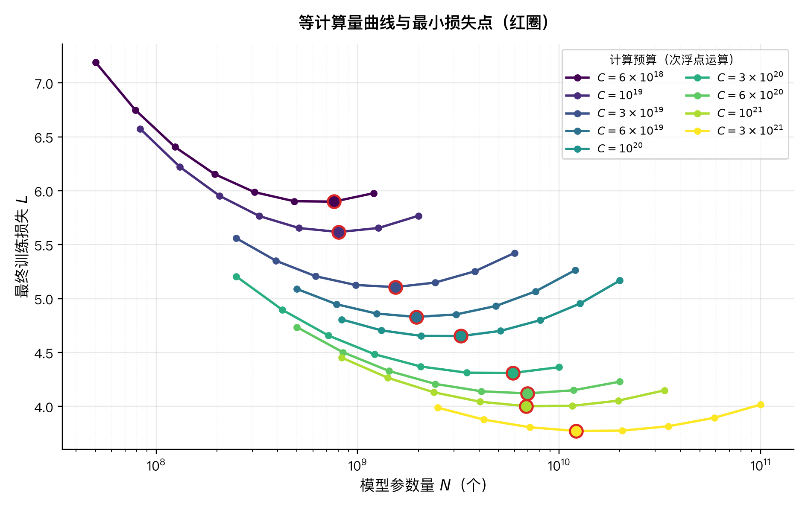
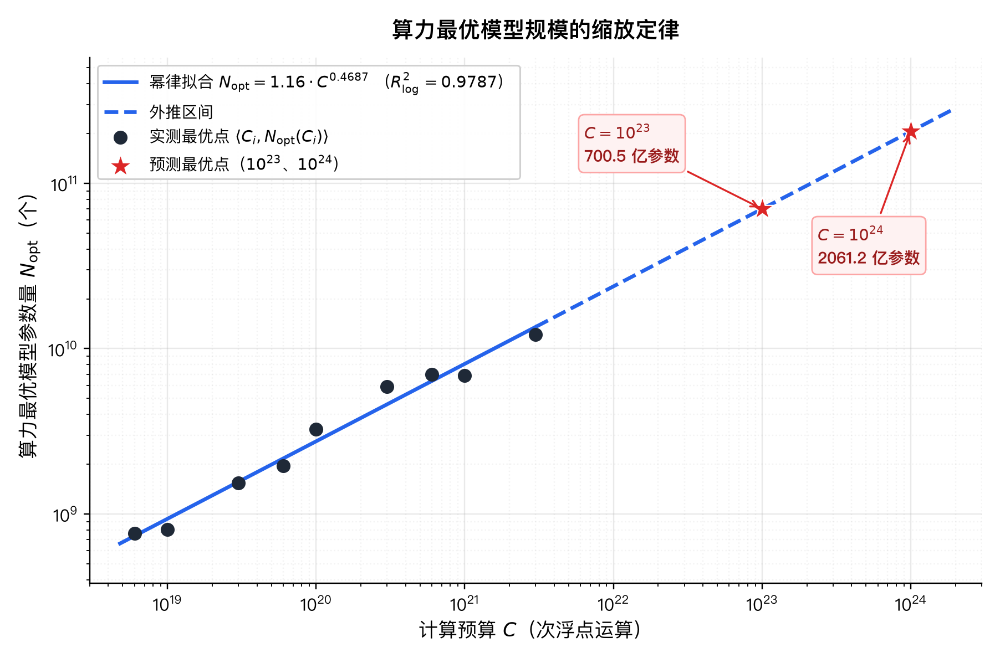
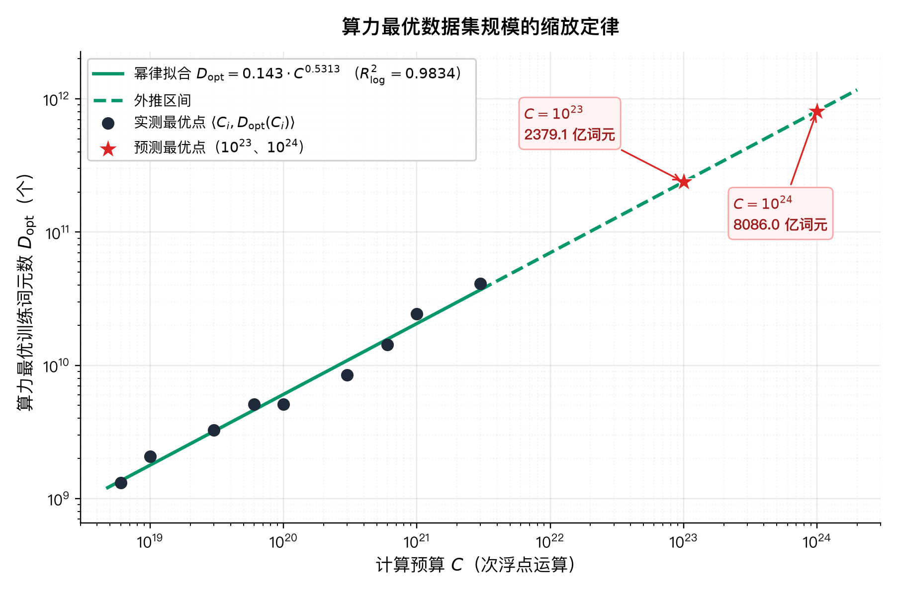

# 作业三：语言模型缩放定律实验报告

---

## 2.1 等计算量缩放定律复现

### 1. 方法与实现说明

变换器语言模型的训练计算量可用下式近似。

$$
C \approx 6ND
$$

其中 $N$ 为模型参数量，$D$ 为训练词元总数，$C$ 为总计算预算，以浮点运算次数计。按照霍夫曼等人（2022）论文中的**等计算量法（方法二）**及作业要求，我们按以下流程复现缩放定律的拟合过程。

1. **按预算分组并提取最优点**。读取 `data/isoflops_curves.json` 中全部 72 条训练记录，覆盖 9 档计算预算，每档包含 8 种模型规模。按题目建议，对每档预算 $C_i$ 直接选取最终训练损失最低的运行，得到最优模型规模 $N_{\mathrm{opt}}(C_i)$。对应的最优数据集规模为

   $$
   D_{\mathrm{opt}}(C_i) = \frac{C_i}{6 N_{\mathrm{opt}}(C_i)}.
   $$

2. **对数空间幂律拟合**。分别拟合模型和数据规模的幂律

   $$
   \begin{aligned}
   N_{\mathrm{opt}}(C) &= k_N C^a, \\
   D_{\mathrm{opt}}(C) &= k_D C^b.
   \end{aligned}
   $$

   考虑到 $C_i$ 横跨 3 个数量级（$6 \times 10^{18}$ 至 $3 \times 10^{21}$），先对两边取以 10 为底的对数，将幂律转化为线性关系，再做最小二乘拟合。在偏差较小时，对数残差近似反映相对误差，有助于改善数值稳定性，并避免最大算力点主导拟合残差。数据规模、模型规模和算力预算之间满足

   $$
   \log_{10} D_i = \log_{10} C_i - \log_{10} 6 - \log_{10} N_i.
   $$

   由于上述关系在对数空间中是线性的，普通最小二乘会保证 $a + b = 1$ 与 $6k_N k_D = 1$，使外推点满足 $C = 6\widehat{N}\widehat{D}$。

3. **复现脚本与运行命令**。实现代码见 `scripts/fit_isoflops.py`。在作业目录运行以下命令即可复现数值与图表。

   ```bash
   uv run python scripts/fit_isoflops.py
   ```

对数空间中的线性拟合方程为

$$
\begin{aligned}
\log_{10} N_{\mathrm{opt}}(C) &= \log_{10} k_N + a \log_{10} C, \\
\log_{10} D_{\mathrm{opt}}(C) &= \log_{10} k_D + b \log_{10} C.
\end{aligned}
$$

---

### 2. 原始等计算量曲线与最优点

下图展示了 9 档计算预算下的等计算量曲线，红圈标出各档预算下最终训练损失最低的点。9 个最优点均位于各组参数搜索区间的内部。



下表列出各算力预算下的最优模型规模 $N_{\mathrm{opt}}(C_i)$ 和最优训练数据规模 $D_{\mathrm{opt}}(C_i)$。

| 预算（次浮点运算） | 组内位置 | 参数量 | 训练词元数 | 每参数词元数 | 最低训练损失 |
| ---: | :---: | ---: | ---: | ---: | ---: |
| 6.0 × 10¹⁸ | 7 / 8 | 7.6209 × 10⁸（7.6 亿） | 1.3122 × 10⁹（13.1 亿） | 1.72 | 5.8999 |
| 1.0 × 10¹⁹ | 6 / 8 | 8.0665 × 10⁸（8.1 亿） | 2.0662 × 10⁹（20.7 亿） | 2.56 | 5.6179 |
| 3.0 × 10¹⁹ | 5 / 8 | 1.5369 × 10⁹（15.4 亿） | 3.2534 × 10⁹（32.5 亿） | 2.12 | 5.1072 |
| 6.0 × 10¹⁹ | 4 / 8 | 1.9520 × 10⁹（19.5 亿） | 5.1228 × 10⁹（51.2 亿） | 2.62 | 4.8306 |
| 1.0 × 10²⁰ | 4 / 8 | 3.2534 × 10⁹（32.5 亿） | 5.1228 × 10⁹（51.2 亿） | 1.57 | 4.6529 |
| 3.0 × 10²⁰ | 7 / 8 | 5.9038 × 10⁹（59.0 亿） | 8.4691 × 10⁹（84.7 亿） | 1.43 | 4.3112 |
| 6.0 × 10²⁰ | 6 / 8 | 6.9711 × 10⁹（69.7 亿） | 1.4345 × 10¹⁰（143.5 亿） | 2.06 | 4.1212 |
| 1.0 × 10²¹ | 5 / 8 | 6.8593 × 10⁹（68.6 亿） | 2.4298 × 10¹⁰（243.0 亿） | 3.54 | 4.0028 |
| 3.0 × 10²¹ | 4 / 8 | 1.2149 × 10¹⁰（121.5 亿） | 4.1156 × 10¹⁰（411.6 亿） | 3.39 | 3.7732 |

---

### 3. 算力最优模型规模的缩放定律

拟合得到的模型规模幂律为

$$
\begin{aligned}
N_{\mathrm{opt}}(C) &= 1.1634\,C^{0.4687}, \\
a &= 0.4687 \pm 0.0261, \\
R^2_{\log} &= 0.9787.
\end{aligned}
$$

这里的 $R^2_{\log}$ 是在对数空间计算的决定系数。



**结论。** 根据拟合的等计算量缩放定律，在 $10^{23}$ 次浮点运算预算下，预测的算力最优模型规模约为 $7.01 \times 10^{10}$ 个参数（**700.5 亿**），在 $10^{24}$ 次浮点运算预算下约为 $2.06 \times 10^{11}$ 个参数（**2061.2 亿**）。

---

### 4. 算力最优数据集规模的缩放定律

拟合得到的数据集规模幂律为

$$
\begin{aligned}
D_{\mathrm{opt}}(C) &= 0.1433\,C^{0.5313}, \\
b &= 0.5313 \pm 0.0261, \\
R^2_{\log} &= 0.9834.
\end{aligned}
$$



**结论。** 根据拟合的等计算量缩放定律，在 $10^{23}$ 次浮点运算预算下，预测的算力最优数据集规模约为 $2.38 \times 10^{11}$ 个词元（**2379.1 亿**），在 $10^{24}$ 次浮点运算预算下约为 $8.09 \times 10^{11}$ 个词元（**8086.0 亿**）。

---

### 5. 自洽性检验与扩展方法对照

#### 5.1 自洽性检查

主方法先选取每组损失最小的点，再在对数空间拟合，因此满足计算量约束。

$$
\begin{aligned}
a + b &= 0.468683 + 0.531317 = 1.000000, \\
6 k_N k_D &\approx 6 \times 1.163411 \times 0.143257 \approx 1.
\end{aligned}
$$

在 $C = 10^{23}$ 和 $C = 10^{24}$ 次浮点运算处，外推结果均满足

$$
\frac{6\widehat{N}_{\mathrm{opt}}(C)\,\widehat{D}_{\mathrm{opt}}(C)}{C} = 1.000000.
$$

#### 5.2 不同谷底提取与拟合空间对比

为了检验网格离散化误差和拟合空间选择对外推结果的影响，我们在 `scripts/fit_isoflops.py` 中额外对比了另外两种做法：

表中指数后的括号为对数空间的决定系数 $R^2_{\log}$，预测列按「参数量 / 训练词元数」排列，列标题中的预算以浮点运算次数计。最后一列是 $10^{24}$ 次浮点运算处的预算比 $6\widehat{N}\widehat{D}/C$。

| 拟合方案 | 模型指数（决定系数） | 数据指数（决定系数） | 指数之和 | 10²³ 预算下预测 | 10²⁴ 预算下预测 | 预算比 |
| :--- | ---: | ---: | ---: | ---: | ---: | ---: |
| **直接取最小值**，在对数空间拟合（本题主方法） | 0.4687（0.9787） | 0.5313（0.9834） | 1.0000 | 700.5 亿 / 2379.1 亿 | 2061.2 亿 / 8086.0 亿 | 1.0000 |
| **二次拟合求谷底**，在对数空间拟合 | 0.5146（0.9999） | 0.4854（0.9999） | 1.0000 | 911.4 亿 / 1828.6 亿 | 2980.6 亿 / 5591.6 亿 | 1.0000 |
| **直接取最小值**，在原始空间做非线性最小二乘拟合 | 0.4038（0.9491） | 0.5968（0.9612） | 1.0006 | 500.2 亿 / 3370.2 亿 | 1267.6 亿 / 1.33 万亿 | 1.0129 |

#### 5.3 对作业第 3 节的启发

1. **采样间距对直接取最小值的影响**。从等计算量曲线可以看到，在 $C = 10^{21}$ 和 $C = 3 \times 10^{21}$ 次浮点运算处，相邻参数量采样点相差约 1.7 倍，谷底位于两个采样点之间。例如，$C = 10^{21}$ 时，68.6 亿参数对应的损失为 4.0028，116.2 亿参数对应的损失为 4.0060。直接取最小损失点会低估最优参数量，这种方法得到的 $R^2_{\log}$ 为 0.9787。改用 $\log_{10} N$ 上的二次拟合求谷底后，$R^2_{\log}$ 提升至 **0.99994**。在作业第 3 节做真实实验时，围绕谷底拟合二次曲线或加密采样能减少外推方差。
2. **原始空间未加权拟合的影响**。原始空间最小二乘几乎完全由最大的两个点（$10^{21}$ 和 $3 \times 10^{21}$）主导。由于这两个点的参数量受采样间距影响而偏低，原始空间拟合把指数 $a$ 拉低到了 0.4038，将 $10^{24}$ 次浮点运算处的参数预测从约 2060 亿拉低到约 1270 亿，并偏离了计算量约束 $6\widehat{N}\widehat{D} = C$。
